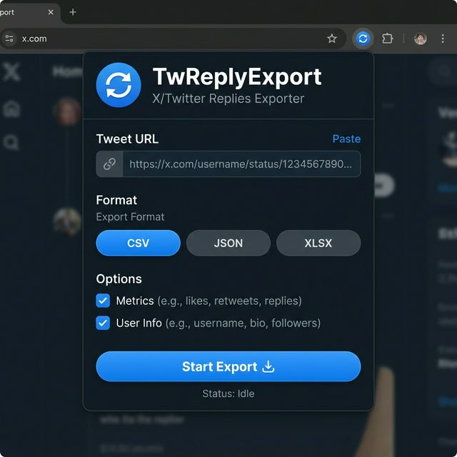

<p align="center">
  
</p>

<h1 align="center">TwReplyExport</h1>
<p align="center">
  <strong>Export replies from any X/Twitter tweet to CSV, JSON, or Excel — 100% locally.</strong>
</p>

<p align="center">
  
  
  
  
</p>

---

<p align="center">
  
</p>

## ✨ Features

| Feature | Description |
|---|---|
| **Multi-format Export** | Download replies as **CSV**, **JSON**, or **XLSX** (Excel) |
| **Auto-scroll Scraping** | Automatically scrolls through all replies — no manual work |
| **Engagement Metrics** | Captures likes, retweets, reply counts, and views per reply |
| **User Info** | Extracts display names, handles, profile URLs, and avatars |
| **Smart Deduplication** | Unique ID generation prevents duplicate entries |
| **Export History** | Stores the last 20 exports locally for quick re-downloads |
| **100% Local** | All data is processed in your browser — nothing sent to any server |
| **Auto-detect URL** | Automatically fills in the tweet URL from your active tab |

## 🚀 Installation

### From source (Developer Mode)

1. **Clone this repo**
   ```bash
   git clone https://github.com/YOUR_USERNAME/TwReplyExport.git
   ```
2. Open **Chrome** → navigate to `chrome://extensions`
3. Enable **Developer mode** (top right toggle)
4. Click **Load unpacked** → select the cloned folder
5. Pin the extension from the toolbar for easy access

## 📖 Usage

1. Navigate to any tweet on **x.com** (or twitter.com)
2. Click the **TwReplyExport** icon in your toolbar
3. The tweet URL is auto-detected — or paste/type one manually
4. Choose your export format: `CSV` · `JSON` · `XLSX`
5. Toggle **Metrics** and **User Info** checkboxes as needed
6. Click **Start Export** — the extension scrolls and collects all replies
7. Hit **Download** when scraping completes

## 📁 Project Structure

```
TwReplyExport/
├── manifest.json      # Chrome extension manifest (MV3)
├── background.js      # Service worker — tab management & message relay
├── content.js         # Content script — DOM scraping & auto-scroll
├── popup.html         # Extension popup UI
├── popup.css          # Dark-themed styles (X/Twitter inspired)
├── popup.js           # Popup controller & state management
├── export.js          # CSV / JSON / XLSX conversion & file download
├── lib/
│   └── xlsx.mini.min.js   # SheetJS for Excel export
└── icons/
    ├── icon16.png
    ├── icon48.png
    └── icon128.png
```

## 🔒 Permissions

| Permission | Why it's needed |
|---|---|
| `activeTab` | Read the current tab URL to auto-detect tweets |
| `scripting` | Inject the content script into X/Twitter pages |
| `storage` | Save export history locally |
| `Host: x.com, twitter.com` | Access tweet pages to scrape replies |

## 📦 Export Fields

<details>
<summary><strong>Core fields</strong> (always included)</summary>

- Display Name
- Handle (`@username`)
- Reply Text
- Timestamp
</details>

<details>
<summary><strong>Metrics</strong> (optional)</summary>

- Likes
- Retweets
- Replies
- Views
</details>

<details>
<summary><strong>User Info</strong> (optional)</summary>

- Profile URL
- User Bio
- Website
- Location
- Follower Count
- Following Count
</details>

## 🛠️ Tech Stack

- **Chrome Extension Manifest V3**
- **Vanilla JavaScript** — no frameworks, no build step
- **[SheetJS](https://sheetjs.com/)** — Excel (XLSX) export
- **Inter** font for clean typography
- Premium dark theme inspired by X/Twitter

## 📄 License

This project is licensed under the [MIT License](LICENSE).

---

<p align="center">
  Made with ☕ — <em>Scrape responsibly.</em>
</p>
